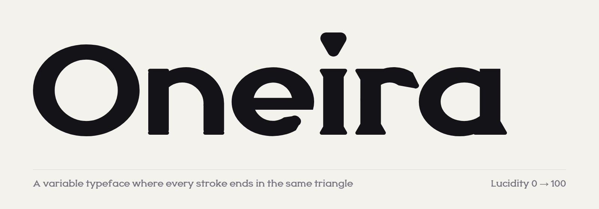
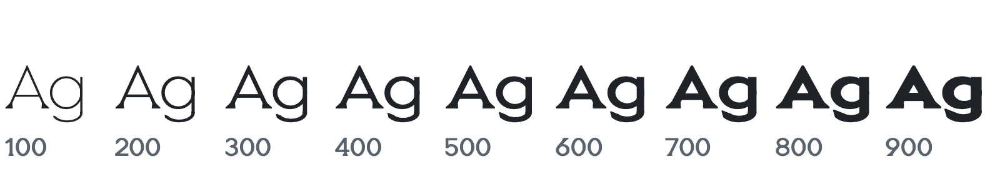
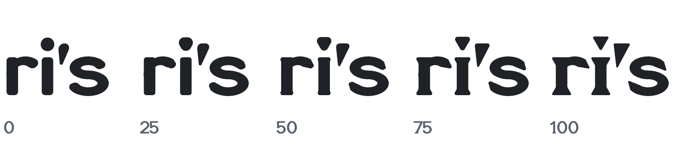

<picture>
  <source media="(prefers-color-scheme: dark)" srcset="docs/images/hero-dark.png">
  
</picture>

# Oneira

A variable typeface where every stroke ends in the same triangle. Two axes: **Weight** from 100 to 900, and **Lucidity** from 0 (dream, soft and round) to 100 (lucid, sharp triangles). Lucidity defaults to **25**, our pick for most text.

<picture>
  <source media="(prefers-color-scheme: dark)" srcset="docs/images/weight-dark.png">
  
</picture>

<picture>
  <source media="(prefers-color-scheme: dark)" srcset="docs/images/lucidity-dark.png">
  
</picture>

218 characters: Basic Latin and Latin-1.

## Install

[Download](https://github.com/abhaymettu/oneira/archive/refs/heads/main.zip) and use `fonts/variable/Oneira[LUCD,wght].ttf`. Static files are in `fonts/static`: Oneira (Lucidity 25), Oneira Dream (0) and Oneira Lucid (100). WOFF2 files are in `fonts/webfonts`.

## Web

```css
@font-face {
  font-family: "Oneira";
  src: url("Oneira[LUCD,wght].woff2") format("woff2");
  font-weight: 100 900;
}

body {
  font-family: "Oneira";
}

h1 {
  font-variation-settings: "LUCD" 100;
}
```

## Build

```sh
python -m venv .venv && .venv/bin/pip install fontmake ufoLib2 brotli fontbakery
.venv/bin/python tools/build.py --release
```

Every glyph is drawn in Python. Design rules: [DESIGN.md](DESIGN.md).

## License

[SIL Open Font License 1.1](OFL.txt). Made by [Abhay Mettu](https://github.com/abhaymettu).
