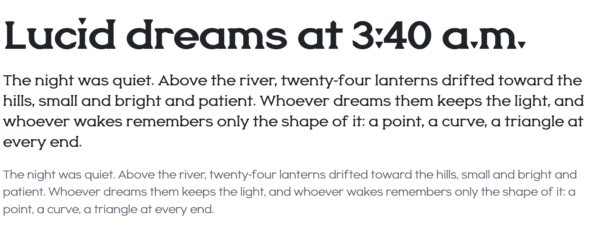
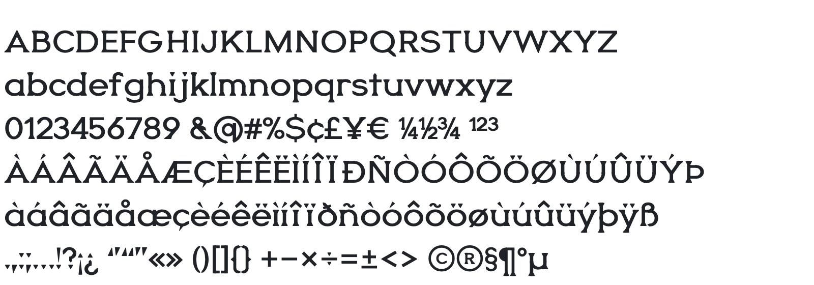

<picture>
  <source media="(prefers-color-scheme: dark)" srcset="docs/images/hero-dark.png">
  
</picture>

# Oneira

**A variable typeface where every stroke ends in the same triangle.** Stems stand on equilateral wedges, curves end in 60 degree tips, and the dot on the i is the triangle itself. Two axes: **Weight** from Thin 100 to Black 900, and **Lucidity**, from 0 (dream) to 100 (lucid).

The name comes from the Greek *oneiros*, dream.

<p>
  <a href="https://github.com/abhaymettu/oneira/archive/refs/heads/main.zip"><b>Download</b></a> ·
  <a href="#use-it-on-the-web">Use on the web</a> ·
  <a href="#build-from-source">Build from source</a> ·
  <a href="OFL.txt">SIL OFL 1.1</a>
</p>

## Weight

Nine named weights, and every value between them.

<picture>
  <source media="(prefers-color-scheme: dark)" srcset="docs/images/weight-dark.png">
  
</picture>

## Lucidity

At 0 Oneira is a soft, rounded geometric sans. Move toward 100 and the triangles grow in and the corners tighten.

<picture>
  <source media="(prefers-color-scheme: dark)" srcset="docs/images/lucidity-dark.png">
  
</picture>

<picture>
  <source media="(prefers-color-scheme: dark)" srcset="docs/images/rule-dark.png">
  
</picture>

## In text

<picture>
  <source media="(prefers-color-scheme: dark)" srcset="docs/images/text-dark.png">
  
</picture>

## Character set

218 characters covering Basic Latin and Latin-1: every Latin-1 accented letter, Æ Ø Ð Þ ß, currency, fractions, superiors and ordinals. Accents are built from real components. Kerning is class based and scales with weight.

<picture>
  <source media="(prefers-color-scheme: dark)" srcset="docs/images/charset-dark.png">
  
</picture>

## Install

[Download the repository](https://github.com/abhaymettu/oneira/archive/refs/heads/main.zip) and open the `fonts` folder.

| Folder | What is in it |
| --- | --- |
| `fonts/variable` | `Oneira[LUCD,wght].ttf`, both axes in one file |
| `fonts/static` | Nine weights of **Oneira** (lucid) and nine of **Oneira Dream** |
| `fonts/webfonts` | WOFF2 of all of the above |

For desktop apps, install the variable TTF. Apps that do not handle variable fonts can use the static files.

## Use it on the web

```css
@font-face {
  font-family: "Oneira";
  src: url("Oneira[LUCD,wght].woff2") format("woff2");
  font-weight: 100 900;
}

h1 {
  font-family: "Oneira";
  font-weight: 800;
  font-variation-settings: "LUCD" 100;
}

.dream {
  font-variation-settings: "LUCD" 0;
}
```

Lucidity is a custom axis, so set it with `font-variation-settings`. It animates well: put a transition on `font-variation-settings` and text can wake up on hover or on scroll.

| Axis | Tag | Range | Default |
| --- | --- | --- | --- |
| Weight | `wght` | 100 to 900 | 400 |
| Lucidity | `LUCD` | 0 to 100 | 100 |

## Build from source

No glyph here was drawn by hand in a font editor. Every glyph is Python: a few primitives (stems, bowls, arcs, the wedge, the tip) and a stroke model that knows how heavy a stem, a bar and a diagonal should be at any weight. The code draws six masters, Thin, Regular and Black at both ends of Lucidity, and fontmake interpolates between them.

```sh
python -m venv .venv && .venv/bin/pip install fontmake ufoLib2 brotli fontbakery
.venv/bin/python tools/build.py            # masters and the variable font
.venv/bin/python tools/build.py --release  # plus static fonts and WOFF2
.venv/bin/python tools/proof.py out.png "Hamburgefonts"   # proof in Chromium
.venv/bin/python tools/readme_images.py    # the images on this page
```

The design rules every glyph is checked against are in [DESIGN.md](DESIGN.md). Notes for contributors and coding agents are in [AGENTS.md](AGENTS.md).

## License

Oneira is licensed under the [SIL Open Font License 1.1](OFL.txt). Use it in anything, commercial work included. You can modify it and share your version, as long as you keep it under the same license and do not sell the font files on their own.

Made by [Abhay Mettu](https://github.com/abhaymettu).
