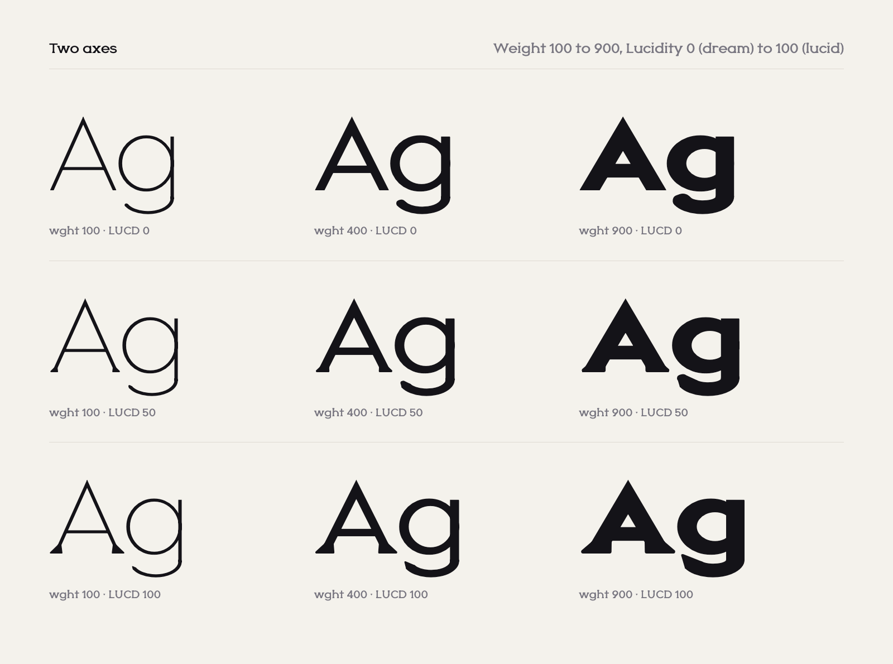

<picture>
  <source media="(prefers-color-scheme: dark)" srcset="docs/images/hero-dark.png">
  
</picture>

# Oneira

Oneira is an open-source variable typeface with one rule: every stroke ends in the same triangle. Straight stems stand on equilateral wedges. Curves end in 60 degree tips. The dot on the i is the triangle itself.

A second axis, **Lucidity**, takes the face from dream to waking. At 0 it is a soft, rounded geometric sans. At 100 the triangles have grown in and the corners tighten. Weight runs from Thin to Black.

The name comes from the Greek *oneiros*, dream.

<picture>
  <source media="(prefers-color-scheme: dark)" srcset="docs/images/axes-dark.png">
  
</picture>

## Axes

| Axis | Tag | Range | Default |
| --- | --- | --- | --- |
| Weight | `wght` | 100 to 900 | 400 |
| Lucidity | `LUCD` | 0 (dream) to 100 (lucid) | 100 |

```css
@font-face {
  font-family: "Oneira";
  src: url("Oneira[LUCD,wght].woff2") format("woff2");
  font-weight: 100 900;
}

h1 { font-family: "Oneira"; font-weight: 800; font-variation-settings: "LUCD" 100; }
.dreamy { font-variation-settings: "LUCD" 0; }
```

Lucidity is a custom axis, so set it with `font-variation-settings`. It animates well: a transition on `font-variation-settings` lets text wake up on hover or on scroll.

<picture>
  <source media="(prefers-color-scheme: dark)" srcset="docs/images/rule-dark.png">
  
</picture>

## Text

<picture>
  <source media="(prefers-color-scheme: dark)" srcset="docs/images/text-dark.png">
  
</picture>

## Character set

Basic Latin and Latin-1: 218 glyphs, including every Latin-1 accented letter, Æ Ø Ð Þ ß, currency, fractions, superiors and ordinals. Accented letters are built from real components. Kerning is class based and scales with weight.

<picture>
  <source media="(prefers-color-scheme: dark)" srcset="docs/images/charset-dark.png">
  
</picture>

## Files

| Folder | What is in it |
| --- | --- |
| `fonts/variable` | `Oneira[LUCD,wght].ttf`, both axes in one file |
| `fonts/static` | Nine weights of **Oneira** (lucid) and nine of **Oneira Dream**, overlaps removed |
| `fonts/webfonts` | WOFF2 of all of the above |

## How it is made

Nothing here was drawn by hand in a font editor. Every glyph is Python: a few primitives (stems, bowls, arcs, the wedge, the tip) and a stroke model that knows how heavy a stem, a bar and a diagonal should be at any weight. The same code draws six masters, Thin, Regular and Black at both ends of Lucidity, and fontmake interpolates between them.

```sh
python -m venv .venv && .venv/bin/pip install fontmake ufoLib2 brotli fontbakery
.venv/bin/python tools/build.py            # masters and the variable font
.venv/bin/python tools/build.py --release  # plus static fonts and WOFF2
.venv/bin/python tools/proof.py out.png "Hamburgefonts"   # proof in Chromium
```

The design rules every glyph is checked against are in [DESIGN.md](DESIGN.md). Notes for contributors and coding agents are in [AGENTS.md](AGENTS.md).

## License

Oneira is licensed under the [SIL Open Font License 1.1](OFL.txt). Use it in anything, commercial work included. You can modify it and share your version, as long as you keep it under the same license and do not sell the font files on their own.
